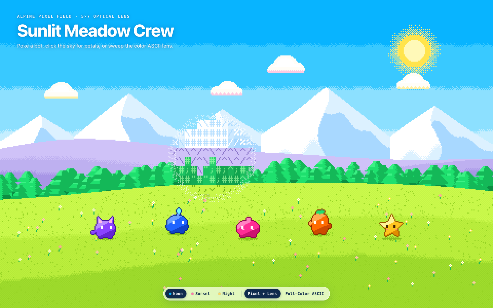
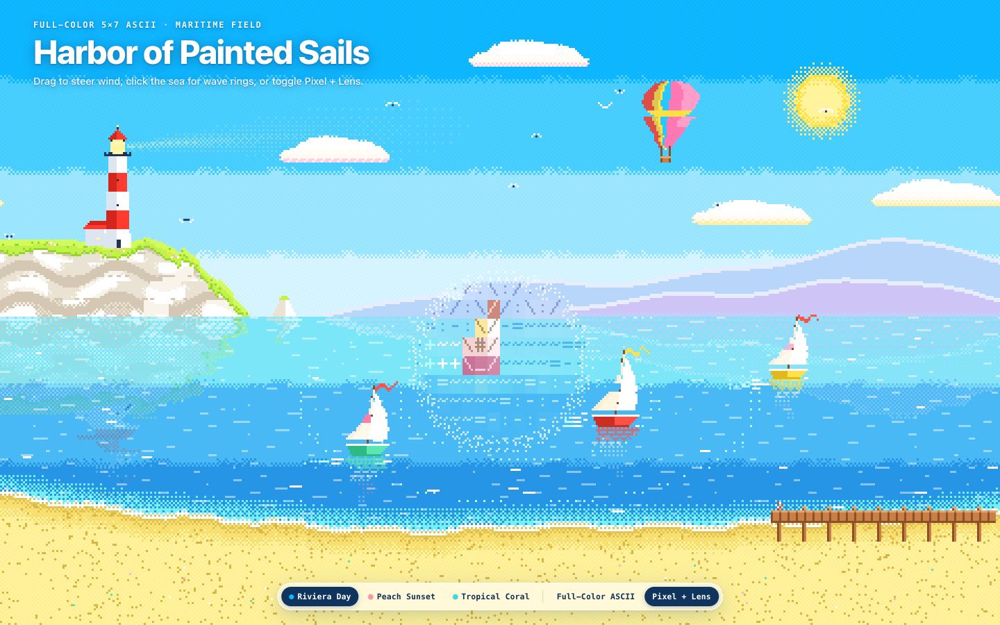
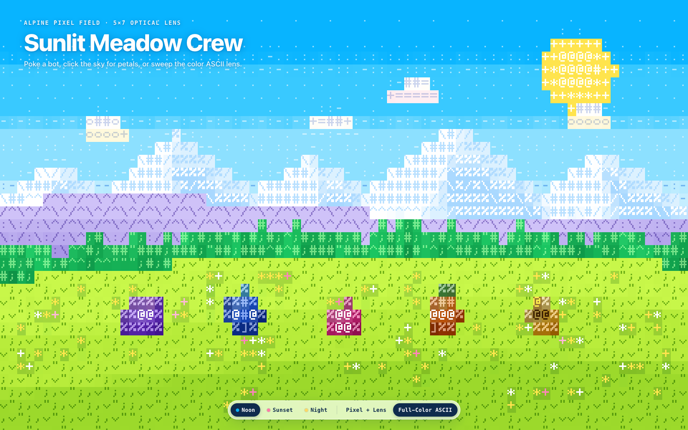
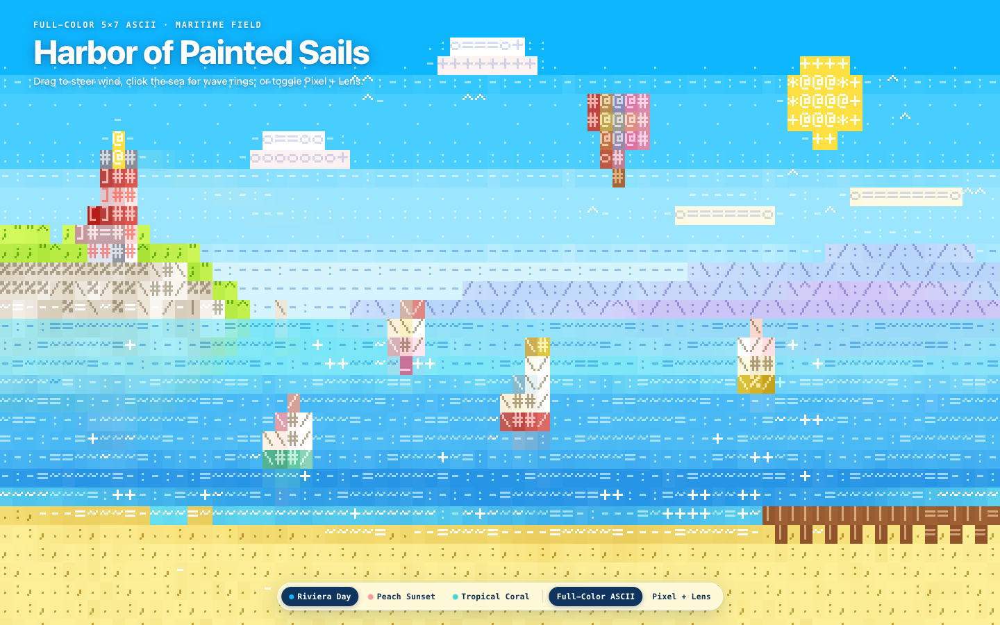
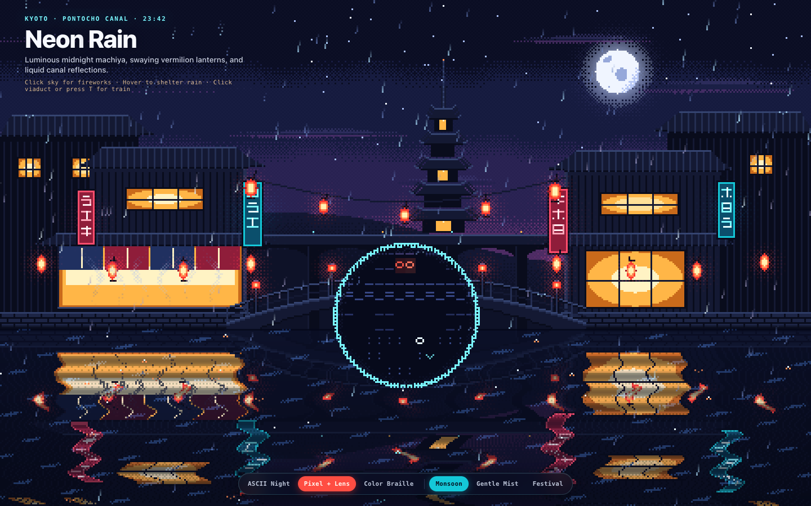
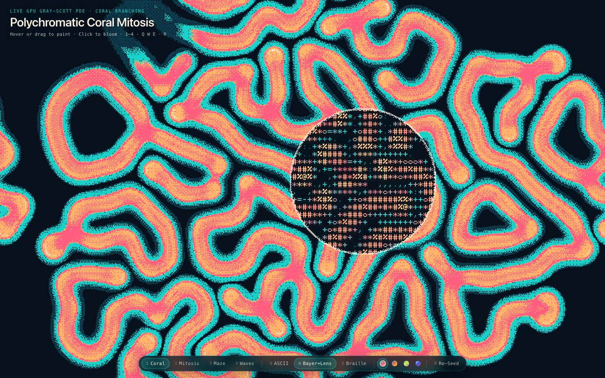
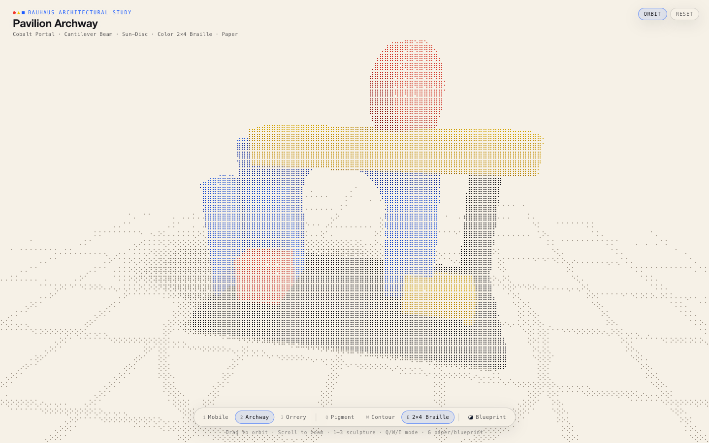
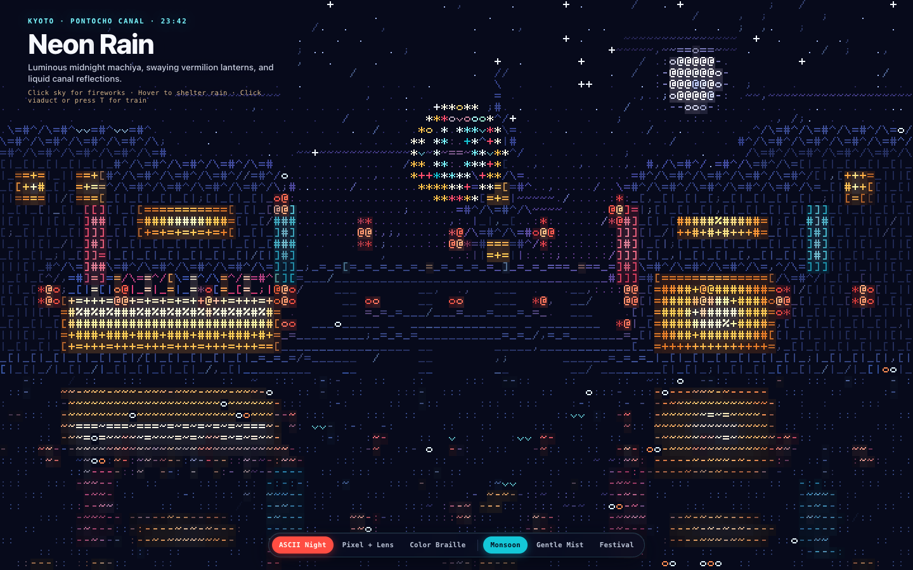
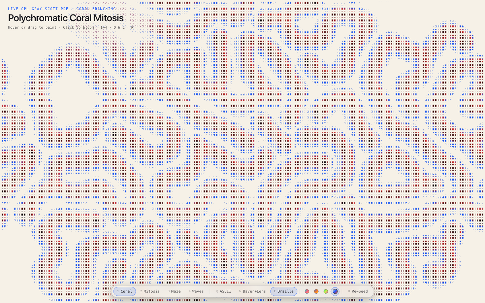
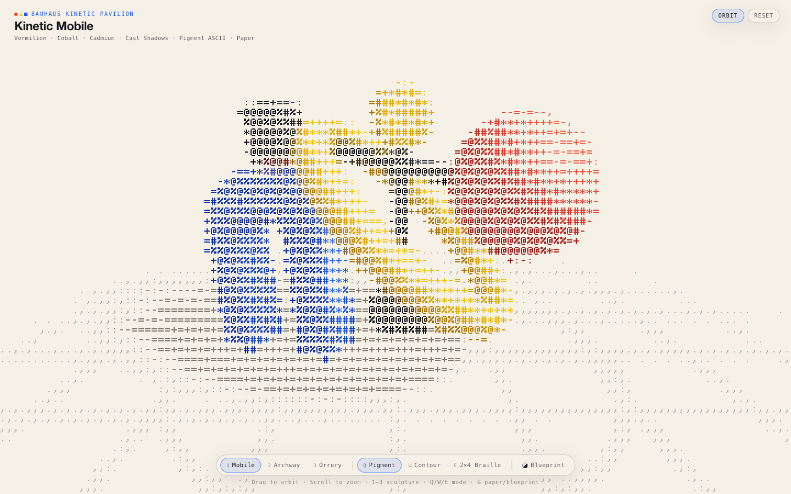

# ascii-animation

An agent skill for building crisp, GPU-accelerated ASCII, ordered Bayer 4×4 dither, full-scale bright polychromatic illustrated worlds, live WebGL2 reaction-diffusion PDEs, multi-material 3D raymarched/Braille sculptures, and kinetic typographic animations.

Inspired by the pixel-locked optical craft of [joinariapp.com](https://joinariapp.com/) and the vibrant multi-plane pixel worlds & procedural characters of [dusk.bot](https://dusk.bot/).

| Sunlit Alpine Meadow & Pixel Crew | Harbor of Painted Sails |
| :---: | :---: |
|  |  |
|  |  |

| Neon Rain in Pixel Kyoto | Polychromatic Coral Mitosis (GPU PDE) | Bauhaus Kinetic Pavilion (3D SDF) |
| :---: | :---: | :---: |
|  |  |  |
|  |  |  |

---

## Install

### Devin CLI & Devin Cloud (recommended)

```bash
devin plugins install abdraiymbek/ascii-animation
```

Or in **Devin Cloud** (**Customize → Plugins → Add plugin → From repository**), enter:

```text
abdraiymbek/ascii-animation
```

Once installed, invoke with `/ascii-animation:ascii-animation` or let Devin activate it automatically on ASCII / dither / pixel-scene prompts.

### Claude Code, Codex, Cursor, Windsurf & `.agents` (`skills.sh`)

```bash
npx skills add abdraiymbek/ascii-animation
```

### Manual install (any tool)

```bash
git clone https://github.com/abdraiymbek/ascii-animation.git /tmp/ascii-animation
# Project-level (.devin/skills or .agents/skills):
cp -r /tmp/ascii-animation/skills/ascii-animation .devin/skills/ascii-animation
# Or user-level global install:
cp -r /tmp/ascii-animation/skills/ascii-animation ~/.agents/skills/ascii-animation
```

---

## What the Skill Covers

The skill routes prompts across six composable archetypes backed by zero-dependency technical references:

- **Archetype A — Bayer Atmospheric Worlds & ASCII Lens** (`references/bayer-dither-atmosphere.md`): integer-device-pixel 3-pass WebGL2 pipeline (`FIELD -> GLYPHPASS -> BLIT`), aperiodic `pcg2` noise, rotated FBM, 3-deck parallax clouds, celestials, aurora, `[data-dim]` legibility thinning, and cloned-canvas 2D fallback.
- **Archetype B — Procedural & Live GPU PDE ASCII Shaders** (`references/ascii-glyph-engine.md`): hand-packed `5×7` GLSL bitmap glyphs (`GLYPH_10`, `GLYPH_17`, `SCENE_24`), True-Color Polychromatic RGB ASCII, curl-noise fluids, bathymetric contours, and real-time WebGL2 ping-pong Gray-Scott reaction-diffusion (`RGBA16F` + `gl.NEAREST` 16-bit-packed `RGBA8` portability).
- **Archetype C — 3D Raymarched SDFs, Contours & GPU 2×4 Braille** (`references/3d-sdf-and-braille.md`): dual-MRT multi-material 3D SDFs, soft penumbra cast shadows, portrait distance compensation, directional silhouette strokes (`- _ | / \`), and zero-readback monochrome or True-Color GPU `2×4` Braille.
- **Archetype D — Kinetic ASCII Typography & Morphs** (`references/kinetic-type-and-sprites.md`): stepped Bayer `--dz1..--dz7` condensation reveals, passing cloud-wisp masks, and tone-bucketed spring-physics typography & emblem morphing.
- **Archetype E — Living Cell-Grid Entities & Procedural SDF Characters** (`references/kinetic-type-and-sprites.md`, `references/illustrated-scenes.md`): zero-GC bird V-formations, fish schools, Bayer-dissolving wakes/contrails, and `mascot.js`-style SDF characters with cursor gaze, blinking, spring pokes, and social neighbor glances.
- **Archetype F — Full-Scale Bright Polychromatic Illustrated Worlds** (`references/illustrated-scenes.md`): 5–7 parallax depth planes, stepped 2–4 cell pixel-dither sky/water seams, subtle screenprint micro-weave grain, animated scanline water reflections, portrait landform scaling, and dual Pixel+Lens / Full-Color ASCII compositing.

---

## Bundled Zero-Dependency Scripts

- **`skills/ascii-animation/scripts/pack-glyphs.mjs`** — packs `5×7` ASCII glyph bitmaps into GLSL `uint` arrays (`GLYPH_10`, `GLYPH_17`, `SCENE_24`, or custom JSON).
- **`skills/ascii-animation/scripts/verify-animation.mjs`** — pure Node 22+ headless Chromium CDP verifier (no `npm install` needed). Captures desktop motion frames (`t1`, `t2`), pointer hover, drag gestures (`--drag`), UI state switches (`--click "<sel>:<label>[@x,y]"`), direct canvas clicks (`--click-pos "x,y:<label>"`), `390×844` mobile layout, and `prefers-reduced-motion: reduce`, reporting real pixel diff ratios, saturation/hue-bin metrics, overflow, and console/WebGL errors.

```bash
node skills/ascii-animation/scripts/verify-animation.mjs showcases-v3/01-sunlit-meadow-crew.html \
  --out ./ascii-audit \
  --click-pos "720,660:poke" \
  --click "#mode-ascii:full-ascii"
```

---

## Showcases Included

Open either gallery hub locally in any browser (every showcase is a standalone, zero-dependency HTML file):

### v3 Suite — Polychromatic Worlds & Evolved Abstracts ([`showcases-v3/index.html`](showcases-v3/index.html))
1. [`showcases-v3/01-sunlit-meadow-crew.html`](showcases-v3/01-sunlit-meadow-crew.html) — Bright `dusk.bot`-style alpine meadow, 5 interactive SDF pixel bots, Color `5×7` ASCII Lens, Full-Color ASCII, Sunset & Starry Campfire Night
2. [`showcases-v3/02-harbor-painted-sails.html`](showcases-v3/02-harbor-painted-sails.html) — Full-Color ASCII coastal harbor, chalk cliffs, lighthouse beam, pastel sailboats, water reflections & live drag wind-steering
3. [`showcases-v3/03-neon-kyoto-rain.html`](showcases-v3/03-neon-kyoto-rain.html) — Nocturnal Kyoto canal street, swaying vermilion lanterns, scanline reflections, deflected rain, gliding train & click fireworks
4. [`showcases-v3/04-coral-mitosis-rd.html`](showcases-v3/04-coral-mitosis-rd.html) — Real-time WebGL2 ping-pong Gray-Scott reaction-diffusion PDE with chemical brush painting, Acid Risograph Paper & Color `2×4` Braille
5. [`showcases-v3/05-bauhaus-3d-kinetic.html`](showcases-v3/05-bauhaus-3d-kinetic.html) — Multi-material Bauhaus 3D raymarched sculptures with soft cast floor shadows on Warm Gallery Paper & Midnight Blueprint

### v2 Suite — Monochrome OKLab & Optical Foundations ([`showcases/index.html`](showcases/index.html))
- [`showcases/01-glacier-sky-lens.html`](showcases/01-glacier-sky-lens.html) — Aria-inspired Glacier Sky Bayer cloudscape, day-to-night cycle, aurora & `5×7` ASCII lens
- [`showcases/02-3d-sdf-singularity.html`](showcases/02-3d-sdf-singularity.html) — Geodesic ray-bending black hole, Torus Knot & Ringed Exoplanet (Luminance / Contour / GPU `2×4` Braille)
- [`showcases/03-bioluminescent-tide.html`](showcases/03-bioluminescent-tide.html) — Curl-noise fluid currents, bathymetric contours, interference caustics & swimming schools
- [`showcases/04-kinetic-ascii-type.html`](showcases/04-kinetic-ascii-type.html) — Morphing letterpress ASCII typography & Solar Emblem studio with live custom text input

---

## Repository Layout

```text
.devin-plugin/plugin.json                     # Devin CLI & Devin Cloud plugin manifest
skills/ascii-animation/
├── SKILL.md                                  # Core playbook, 10 laws & prompt router
├── references/
│   ├── illustrated-scenes.md                 # Full-scale bright polychromatic worlds & SDF characters
│   ├── bayer-dither-atmosphere.md            # Aria-grade WebGL2 Bayer sky, celestials & [data-dim]
│   ├── ascii-glyph-engine.md                 # 5x7 GPU bitmaps, True-Color ASCII & Gray-Scott PDEs
│   ├── 3d-sdf-and-braille.md                 # Multi-material 3D SDFs, contours & Color GPU Braille
│   ├── kinetic-type-and-sprites.md           # Bayer mask reveals, morphs & living pixel-grid entities
│   └── prompt-recipes.md                     # Prompt translation table, anti-slop rules & audit rubric
└── scripts/
    ├── pack-glyphs.mjs                       # 5x7 bitmap -> GLSL uint packer
    └── verify-animation.mjs                  # Zero-dep headless Chromium multi-state CDP verifier
showcases-v3/                                 # 5 standalone v3 showcases + gallery hub
showcases/                                    # 4 standalone v2 showcases + gallery hub
assets/previews/                              # Verification preview stills
```

## License

MIT
